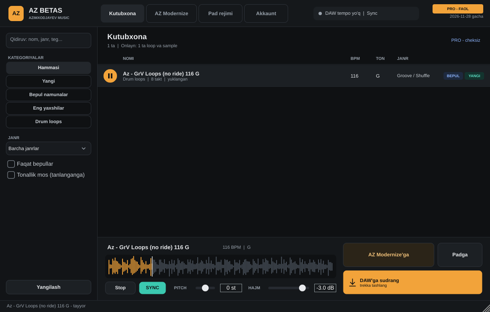
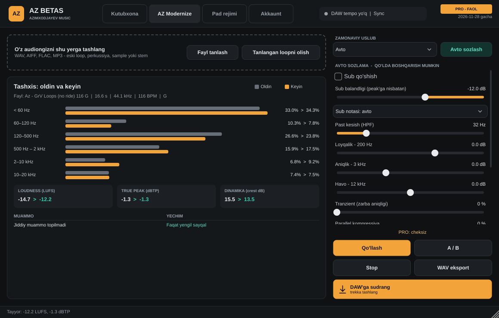

# AZ BETAS — Azimxodjayev Music

DAW ichida ishlaydigan onlayn loop va sample kutubxonasi (VST3 / AU instrument).
Admin yangi loop'larni yuklaydi, obunachilar ularni Cubase, FL Studio, Ableton va
boshqa DAW'larda tempo'ga moslab darhol ishlatadi.

## Imkoniyatlar

| Bo'lim | Nima qiladi |
|---|---|
| Kutubxona | Onlayn katalog, qidiruv, kategoriya, janr, "Yangi", "Bepul namunalar", "Eng yaxshilar" |
| Tempo sync | Loop DAW tempo'siga avtomatik cho'ziladi (sifatli time-stretch), choksiz aylanadi |
| Pitch | ±12 yarim ton, tonallik nomi avtomatik o'zgaradi |
| DAW'ga sudrash | Tayyor loop WAV bo'lib trekka sudrab tashlanadi |
| Pad rejimi | 8 ta pad (MIDI C1–G1), DAW bilan taktma-takt sinxron |
| AZ Modernize | O'z audiongizni import qilish → tashxis jadvali → avto sozlama → sub, EQ, tranzient, parallel kompressiya, LUFS, True Peak limiter → A/B → eksport |
| Oflayn kesh | Yuklangan loop'lar internetsiz ham ishlaydi |

## Tariflar

| Tarif | Narx | Imkoniyat |
|---|---|---|
| Bepul | 0 | Hamma narsani tinglash, 10 tagacha loop DAW'da, "Bepul" belgili loop'lar cheksiz, Modernize: faqat tashxis |
| Start | 25 000 so'm / oy | Butun kutubxona, Modernize oyiga 5 fayl |
| PRO | 50 000 so'm / oy | Hammasi cheksiz, yangiliklarga 3 kun oldin kirish |
| PRO yillik | 300 000 so'm | PRO, 365 kun |

## Plaginni o'rnatish (Windows)

1. GitHub → **Actions** → oxirgi yashil "Build AZ BETAS plug-in" → pastdagi **AZ-BETAS-Windows** arxivini yuklab oling.
2. `AZ BETAS.vst3` papkasini `C:\Program Files\Common Files\VST3\` ga ko'chiring.
3. DAW'da plaginlarni qayta skanerlang va **instrument trek** sifatida "AZ BETAS"ni oching.

macOS uchun **AZ-BETAS-macOS** arxivi: `.vst3` → `~/Library/Audio/Plug-Ins/VST3/`, `.component` → `~/Library/Audio/Plug-Ins/Components/`.

## Admin: birinchi sozlash (bir marta)

1. **Repo Public bo'lsin** — plagin kutubxonani `raw.githubusercontent.com` orqali yuklaydi.
2. **GitHub Pages**: Settings → Pages → Branch `main` / `(root)` → Save.
   Admin panel manzili: `https://alifrecords.github.io/AZ-Beats/admin/`
3. **Token**: GitHub → Settings → Developer settings → Fine-grained tokens →
   faqat `AZ-Beats` repo, **Contents: Read and write**. Admin panel → Sozlamalar → tokenni qo'ying.
4. **Kalitlar juftligi**: Admin panel → Kalitlar → "Yangi juftlik yaratish".
   - Maxfiy kalit faqat brauzeringizda qoladi, zaxira JSON fayli yuklab olinadi — **xavfsiz saqlang**.
   - Ochiq kalit `config/license_public_key.txt` ga yoziladi va plagin avtomatik qayta yig'iladi.

## Admin: har kungi ish

| Ish | Qayerda |
|---|---|
| Yangi loop yuklash | Admin panel → Yuklash (kategoriya, janr, Bepul / Namuna belgilari) |
| BPM, tonallik, takt | GitHub Actions o'zi aniqlaydi (fayl nomida bo'lsa, o'sha olinadi: `Az - Doira 104 Am.wav`) |
| Bepul qilish / namunaga qo'yish | Admin panel → Kutubxona → katakchalar → "O'zgarishlarni saqlash" |
| Bepul limitni o'zgartirish | Admin panel → Sozlamalar |
| To'lovdan keyin kalit berish | Admin panel → Kalitlar → foydalanuvchi, tarif, muddat → "Telegram xabari bilan nusxa" |

Kalit 30 kun (yillik — 365 kun) amal qiladi. Muddat tugasa, plagin avtomatik Bepul tarifga o'tadi.

## Texnik

- JUCE 8.0.4, C++17, CMake. Time-stretch: Signalsmith Stretch (MIT).
- Litsenziya: RSA-2048 imzo (SHA-256), plagin faqat ochiq kalit bilan tekshiradi.
- Kutubxona: `library/files/<Kategoriya>/<fayl>.flac`, `library/meta.json` (admin), `library/catalog.json` (avto).
- Lokal test: `cmake -B build -DAZ_BUILD_TESTS=ON && cmake --build build --target AZBetasTest`
  - `AZBetasTest analyse file.wav` — tashxis
  - `AZBetasTest modernize in.wav out.wav [uslub 0-5]`
  - `AZBetasTest verify <kalit>`

## Cheklovlar (hozirgi versiya)

- Loop fayllari public repoda turadi: tinglash bepul bo'lgani uchun bu maqsadga mos, lekin texnik biluvchi odam fayllarni to'g'ridan-to'g'ri yuklab olishi mumkin.
- Bepul limit hisoblagichi foydalanuvchi kompyuterida saqlanadi.
- Kalitlar oflayn tekshiriladi: obunani muddatidan oldin bekor qilish imkoni yo'q, kalit muddati tugashini kutish kerak.
- macOS versiyasi imzolanmagan (Apple Developer kerak).

Kuchliroq himoya kerak bo'lsa (fayllarni yopiq serverda saqlash, onlayn tekshiruv) — keyingi bosqichda Cloudflare Worker qo'shiladi.
